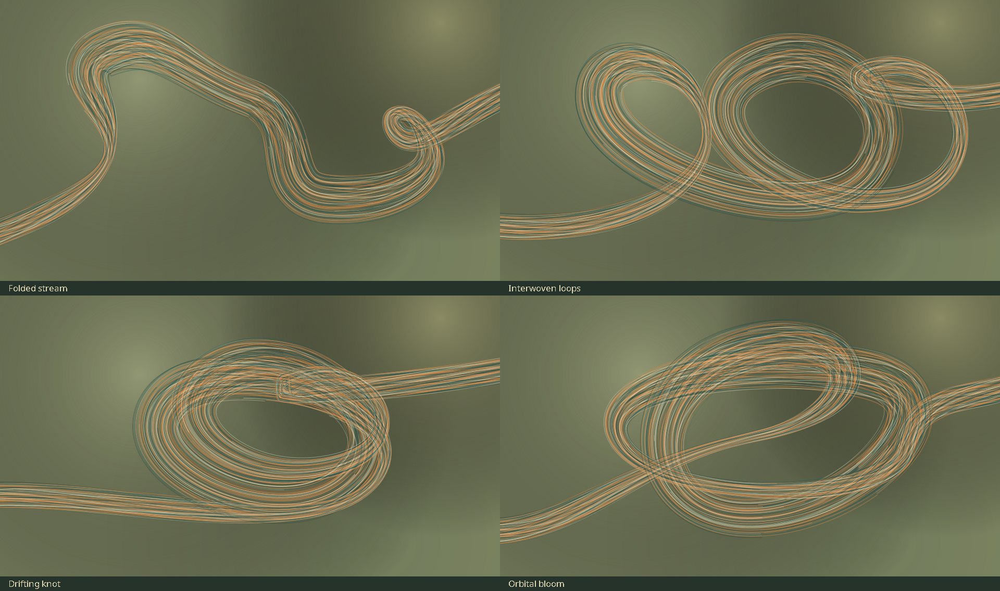

# wallpApp

A personal Android tablet and TV ambient display and screensaver, with one shared APK for touch and remote control. No launcher replacement, system-package disabling, ads, analytics, account, or API key is required.

- **Flow:** original open-filament art drawn with Android Canvas, overhauled to follow the filament preview rather than filled ribbons. Four compositions—**Folded stream, Interwoven loops, Drifting knot, Orbital bloom**—plus **Automatic**, selectable in Settings. Sage is the new default palette; existing saved palette choices remain unchanged, including time-of-day Automatic. Still and reduced-motion options; approximately 30 fps scheduling (33 ms), not a measured device frame-rate claim.
- **Cityscapes:** automatic fetching from a curated catalogue of **12 verified CC0 Wikimedia Commons photographs**, covering Tokyo, New York, Hong Kong, Singapore, London, Chicago, and Seoul. Native **3840 × 2160** decoded crops without upscaling, no ambient photo-credit overlay, and opt-in Image details with creator/source/license links. Crossfades, optional subtle zoom, 30-second/1-minute/5-minute intervals; Flow fallback when no photograph is available.
- **Music:** optional native audio-only Media3 playback, best-effort NewPipe extraction of the default [Lofi Girl stream](https://www.youtube.com/watch?v=rFZHOHl-L8A), direct HTTPS audio, or a local file chosen through Android's document picker. No media is bundled. Music defaults off.
- Optional clock/date, placement, volume/mute, and native touch + D-pad controls. Pages scroll vertically; the ambient button strip scrolls horizontally. Tap the ambient canvas or press OK/arrows to reveal controls; Back exits; media Play/Pause and Next are handled. Controls hide after seven seconds.
- Landscape, full-screen activities on both tablet and TV. The ambient activity requests immersive system-bar hiding; menus use a full-screen theme, so the navigation bar may remain. Dream orientation and system bars depend on firmware.

**Version 1.1** (`versionCode` 2). Integrated debug build, all **15 JVM tests**, and Android lint passed (zero errors). The new APK retains the previous debug signing key for `adb install -r` updates. The city-source evidence records all 12 real images; the unchanged audio integration's prior exact-stream JVM extraction/HTTP probe is retained separately. **No tablet or TV runtime testing is claimed.** See [verification and device checklist](docs/verification.md).

### Flow compositions

Settings → **Flow composition** offers Automatic and the four named compositions. Automatic holds each for **150 motion-seconds**, then morphs to the next over **30 motion-seconds**; motion speed and reduced motion stretch that wall-clock duration, and Still freezes automatic progression. Changing the selector blends from the current shape over approximately **8 elapsed seconds** while Flow is running, including in Still mode.



This is a **host-rendered source preview, not an Android screenshot** or evidence of device rendering/performance.

## Requirements and build

One APK supports Android tablets and Android TV, including **Android 12 (API 31)**; minimum **Android 8 / API 26**, target **API 32 (Android 12L)**. Target SDK is not the minimum or a guarantee of compatibility with every device. Both Leanback and touchscreen hardware are **optional**. `MainActivity` declares both `LAUNCHER` and `LEANBACK_LAUNCHER`, providing an ordinary tablet launcher entry and a TV launcher entry.

| Build input | Version |
| --- | --- |
| Build JVM | JDK **25** |
| Gradle wrapper | **9.3.1**, SHA-256 pinned |
| Android Gradle Plugin | **9.1.1**, built-in Kotlin support |
| Compile SDK | **36.1** (`platforms;android-36.1`) |
| SDK Build Tools | **36.0.0** (AGP default for this configuration) |
| Java bytecode/source compatibility | **17**, with core-library desugaring |
| Media3 / NewPipeExtractor | **1.11.1** / **v0.26.5** |

### Fedora + fish

Run from the project root. Install the official [Android SDK command-line tools](https://developer.android.com/studio#command-tools) into `~/Android/Sdk/cmdline-tools/latest/` so that `latest/bin/sdkmanager` exists (avoid a nested `latest/cmdline-tools/` directory). Review Google's SDK terms before accepting licenses. The SDK download page supplies the current Linux archive and checksum.

```fish
sudo dnf install java-25-openjdk-devel python3 unzip zip android-tools fish
set -gx JAVA_HOME /usr/lib/jvm/java-25-openjdk
set -gx ANDROID_HOME $HOME/Android/Sdk
set -gx ANDROID_SDK_ROOT $ANDROID_HOME
fish_add_path $JAVA_HOME/bin $ANDROID_HOME/cmdline-tools/latest/bin $ANDROID_HOME/platform-tools
java -version
sdkmanager --sdk_root=$ANDROID_HOME --licenses
sdkmanager --sdk_root=$ANDROID_HOME 'platform-tools' 'platforms;android-36.1' 'build-tools;36.0.0'
printf 'sdk.dir=%s\n' $ANDROID_HOME > local.properties
python3 scripts/build.py :app:assembleDebug
```

Use a Fedora release/repository providing JDK 25; otherwise install a trusted JDK 25 distribution and point `JAVA_HOME` at its actual directory. `local.properties` is machine-local: replace a copied checkout's absolute SDK path; do not publish it. Fish variables above apply to the current shell. No system Gradle installation is needed.

`scripts/build.py` uses `.gradle-home` and its `android/` subdirectory by default. **Set `JAVA_HOME` and `ANDROID_HOME` explicitly:** its fallback paths belong to the original developer's machine. `GRADLE_USER_HOME`, `ANDROID_USER_HOME`, and optional `GRADLE_BOOTSTRAP` override its defaults. It forwards HTTP(S) proxy host/port settings to Java; authenticated proxies and `NO_PROXY` exclusions are not implemented. First build needs network access to Gradle distribution hosts, Google Maven, Maven Central, and JitPack. Review dependency/service terms; downloads consume bandwidth. Do not share caches containing credentials or debug signing keys.

Build output: `app/build/outputs/apk/debug/app-debug.apk`. Delivered files: **`dist/AmbientFlow-debug.apk`** and **`dist/AmbientFlow-source.zip`**, with SHA-256 checksums in `dist/SHA256SUMS`. To restage a rebuilt APK:

```fish
mkdir -p dist
cp app/build/outputs/apk/debug/app-debug.apk dist/AmbientFlow-debug.apk
sha256sum dist/AmbientFlow-debug.apk
```

Run `python3 scripts/package.py` after building to regenerate delivery files. The ZIP includes the complete app project, wrapper, documentation and collected dependency sources/provenance. Review `dependency-sources/README.md` before further redistribution: exact desugar binary/source correspondence and its configuration-generator source remain unverified. This personal-use delivery is not a certification of complete public-redistribution compliance.

## Install and start

Enable developer options and debugging on the chosen device and authorize your host. Always select a device explicitly, especially with tablet and TV both attached. These commands assume the APK was staged as above; the original build output is also installable.

### Tablet over USB (fish)

Connect a USB data cable, enable USB debugging, and accept the tablet's authorization prompt:

```fish
adb devices -l
read -P 'Tablet USB serial from adb devices: ' SERIAL
adb -s $SERIAL install -r dist/AmbientFlow-debug.apk
adb -s $SERIAL shell am start -n org.ambientflow.tv/.MainActivity
```

`$SERIAL` is the literal device identifier shown by `adb devices`, not the tablet model name. The ordinary launcher icon also starts the app.

### TV over the network (fish)

```fish
# Configurable example: use the address/port shown by YOUR TV.
set TV_SERIAL 192.168.4.47:5555
adb connect $TV_SERIAL
adb devices -l
adb -s $TV_SERIAL install -r dist/AmbientFlow-debug.apk
adb -s $TV_SERIAL shell am start -n org.ambientflow.tv/.MainActivity
# Optional manual display and app preferences:
adb -s $TV_SERIAL shell am start -n org.ambientflow.tv/.AmbientActivity
adb -s $TV_SERIAL shell am start -n org.ambientflow.tv/.SettingsActivity
```

The example assumes authorized network ADB is already offered by the TV. Wireless-debugging pairing and connection ports may differ; follow the TV's instructions (including pairing if required), rather than assuming port 5555 is available. No `adb tcpip`, root, launcher replacement, package disabling, or other system changes are needed. Use a trusted network and disable debugging when finished.

Package remains **`org.ambientflow.tv`** in v1.1. Install with **`adb install -r`** as above to preserve preferences and app data when upgrading an existing installation signed with the **same debug key**. Version code increases to 2; do not uninstall merely to update a matching-key build. Exact public components:

- `org.ambientflow.tv/.MainActivity` — tablet/TV launcher menu.
- `org.ambientflow.tv/.AmbientActivity` — manual ambient display.
- `org.ambientflow.tv/.SettingsActivity` — app preferences.
- `org.ambientflow.tv/.AmbientDreamService` — system screensaver service, selected through the picker (not started with `am start`).

`ImageDetailsActivity` is internal. A mismatched signing key requires a correctly signed update or uninstall (which loses app data), not disabling package verification. Debug signing is for personal testing, not a production release.

## Screensaver setup (normal route first)

Open the app's **Screensaver setup**, or the normal device screensaver menu: commonly TV **Settings → Device Preferences/System → Screensaver**, or tablet **Settings → Display → Screen saver**. OEM menu paths and availability differ. Select **Ambient Flow**, choose your preferred activation conditions, and use the system's Preview/Start now if offered. The app does not set idle timeouts or sleep/dock triggers. Manual **Start ambient display** keeps the screen on and is not proof that automatic screensaver activation works.

For TVs hiding the picker, use [the inspected, reversible ADB procedure](docs/verification.md#screensaver-inspect-select-restore). It records exact prior values, including absent entries, for the explicit device/user before selecting the dream. It never disables a system screensaver, launcher, or other package, and never automatically changes activation triggers.

## Photographs, source details, and privacy

The requirement permits **any suitable 4K provider**, not an Unsplash-only source; v1.1 implements a fixed reviewed **Wikimedia Commons** catalogue, not an arbitrary-provider search. It uses documented `imageinfo/extmetadata` requests for reviewed file IDs and API-returned standard 3840px renditions: **no scraping, API key, account, or local-import setup**. Both original and delivered dimensions must be at least **3840 × 2160**, with enough measured pixels for a centered 16:9 crop. Metadata and downloaded JPEG dimensions are checked; a nominal “4K” URL is not sufficient. All 12 current records are CC0. Strict runtime eligibility accepts only matching CC0 or explicitly non-attribution-required public-domain metadata with empty restrictions; BY/BY-SA, unknown licenses and undersized images are rejected without relaxing the policy.

Decoding uses small region strips into an exact **3840 × 2160 RGB565** frame, never a full-original bitmap or a 1080p fallback. A frame is about **15.8 MiB**, two crossfade frames about **31.6 MiB**, plus temporary decode/native overhead; this is a source-level memory budget, not a hardware measurement. The private disk cache is capped at **12 photographs / 64 MiB** including reserved download/index space, with a **16 MiB** per-download cap. Matching cached images return without waiting for network work; a single bounded background warmer fills missing selected-city slots. An empty/unusable cache falls back to Flow. The new `commons-unrestricted-city-4k-v2` namespace never loads older BY/BY-SA records. Exit ambient sessions before **Settings → Clear photo cache**; clearing is a no-op while active/busy and also removes the two old owned cache namespaces. Uninstall removes private data.

There is **no ambient photograph-credit overlay**, including during crossfades. **Image details** is opt-in and retains creator/credit, title, Commons source and license links, and crop/optional pan/zoom information. [Commons reuse guidance](https://commons.wikimedia.org/wiki/Commons:Reusing_content_outside_Wikimedia) requires checking each file's terms; Commons is not a blanket license or a copyright warranty. [CC0](https://creativecommons.org/publicdomain/zero/1.0/) imposes no copyright-attribution condition, unlike CC BY/BY-SA. Other rights—including privacy, publicity, trademarks and rights in depicted works—can still apply; do not imply endorsement. See [full notices](THIRD_PARTY_NOTICES.md), [source verification](docs/city-source-verification.md), and the [per-image evidence](docs/city-source-verification.json).

Flow works offline. Cityscapes contacts Wikimedia; default music contacts YouTube and delivery hosts; a custom stream contacts its provider. Providers see ordinary network/request information, including your IP. Audio streaming has no app-managed persistent media cache. Local files need an Android document picker and persistable read permission. No extraction success confers music, performance, download, redistribution, or other media rights. Source/service changes, region restrictions, rate limits, and network failures can break playback. Use only content you may lawfully access.

## Music behavior

Enable **Automatic music** in Settings or Music on the home screen; it then starts without a Play press in each new ambient activity/dream session. Volume is separate from the TV volume; mute is persisted. Playback stops when the ambient screen loses visibility, exits, or loses audio focus. It checks for active music before requesting focus and again before playback; another active media app suppresses startup. Focus loss ends that audio attempt without automatically taking focus back. Network failures leave visuals running and trigger capped exponential retries while the session remains eligible. These are implemented safeguards, not device-verified guarantees about every vendor/media app. Extraction may break when YouTube changes; do not expect permanent compatibility. The exact livestream currently yielded live audio manifests in the host probe, but Android decoding remains untested. Direct HTTPS radio and local audio are optional explicit fallbacks, never silently substituted.

## License and scope

Ambient Flow is **GPL-3.0-or-later**, without warranty; see the full [LICENSE](LICENSE). Third-party licenses and media rights remain distinct. Anyone distributing an APK, including modified downstream builds, must meet the applicable GPL corresponding-source and notice obligations; see [THIRD_PARTY_NOTICES.md](THIRD_PARTY_NOTICES.md). Personal sideloading is the intended use. There is **no Google Play acceptance/policy compliance guarantee**, no affiliation with Google, YouTube, Wikimedia, Lofi Girl, or NewPipe, and no guarantee of any particular TV's firmware behavior.
