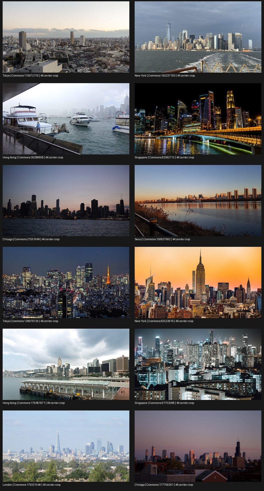

# Automatic, no-credit-required Commons 4K cityscapes

Reviewed/probed **2026-10-20**. The provider requirement now permits Commons.
The earlier Unsplash-only/local-import blocker is superseded: **automatic fetching
is implemented**, without a picker or API key. The catalogue contains **12 real,
network-verified CC0 cityscape photographs covering all seven supported cities**.
No UI source was changed; the parent controls whether credits are shown.

## Reference and reuse basis

The previous repository was read directly from
`dist/AmbientFlow-source.zip`, member
`AmbientFlow/app/src/main/java/org/ambientflow/tv/CityRepository.kt`. Nothing was
extracted over the working tree. Its broad BY/SA license acceptance and 1080p
sampling were not restored.

Relevant public documentation:

- [Commons reuse guidance](https://commons.wikimedia.org/wiki/Commons:Reusing_content_outside_Wikimedia)
  permits reuse subject to each file's conditions and cautions that metadata is
  not a copyright warranty. Public-domain content generally has no strict
  copyright-attribution requirement, depending on jurisdiction.
- [Technical reuse guidance](https://commons.wikimedia.org/wiki/Commons:Reusing_content_outside_Wikimedia/technical)
  explicitly permits downloading/hotlinking; downloading individual files for
  reuse is recommended. This implementation retrieves small metadata batches
  for fixed reviewed file IDs, not a live search proxy or bulk archive crawler.
- [CC0](https://creativecommons.org/publicdomain/zero/1.0/) waives copyright and
  related rights to the extent possible and permits copying, modifying,
  distributing and performing without permission. No copyright credit overlay
  is required by CC0. Do not imply photographer endorsement.
- [Public Domain Mark](https://creativecommons.org/publicdomain/mark/1.0/) is a
  copyright-status indication, **not a license grant or a worldwide warranty**.
- [Action API imageinfo](https://www.mediawiki.org/wiki/API:Imageinfo) documents
  `url`, `size`, `mime`, `extmetadata`, `iiurlwidth`, and small metadata batches.
- [Common thumbnail sizes](https://www.mediawiki.org/wiki/Common_thumbnail_sizes)
  lists **3840px** as a supported production size. API-returned thumbnail URLs
  may represent a different size than the nominal request; delivered bytes must
  be measured.

### Fail-closed eligibility

Both runtime and verification script require:

1. A fixed reviewed catalogue page ID, returned as a Commons-local file page.
2. A JPEG original, width **3840–7680**, height **2160–5120**, landscape, original
   size **1–16 MiB**. These conservative upper bounds also constrain admitted
   catalogue content, even though runtime downloads a smaller rendition.
3. Explicit `AttributionRequired=false`; an explicitly present, empty
   `Restrictions`; `NonFree` absent/empty or explicitly false.
4. Either `LicenseShortName=CC0`, `License=cc0`, and a recognized CC0 URL, or
   `LicenseShortName=Public domain`, `License=pd`, `Copyrighted=false`, with a
   recognized PDM URL or no URL. HTTP CC deed links are recognized but exposed
   as canonical HTTPS status/license URLs. Optional `/deed.en` forms are allowed.
5. Nonempty creator information and HTTPS URLs on the exact approved Commons
   page/image hosts. No redirects, borrowed credentials or undocumented APIs.
6. The API-returned standard 3840px rendition must itself qualify as landscape
   >=3840x2160 and not exceed original dimensions. Delivered JPEG bytes are
   bounded and measured again; a nominal `thumbwidth` is never sufficient.

BY, BY-SA, FAL, GFDL, unknown/mixed-license summaries, missing attribution status,
missing Restrictions metadata, nonfree flags, undersized originals and
insufficient-height thumbnails are rejected. No fallback broadens these rules.
`Copyrighted=True` alone does **not** disqualify CC0: Commons uses that value for
many valid CC0 records. Public-domain records without a source `LicenseUrl` get
an explanatory PDM link in details, not an invented claim that their uploader
applied the mark. **All twelve shipped records currently qualify as CC0**, so
this more jurisdiction-sensitive PD branch is policy-tested, not needed for the
default catalogue.

These checks establish eligibility from Commons' assertions, not an absolute
legal guarantee. CC0 does not waive third-party trademarks, publicity/privacy,
property rights, or rights in depicted artwork. Empty Commons Restrictions is
not a proof that no such rights exist anywhere.

## Real network evidence and subject review

`city-source-verification.json` contains the actual API requests, source page,
photographer, raw and normalized license/restriction metadata, original and
delivered dimensions, actual byte counts, SHA-256 of each downloaded JPEG and
4K crop geometry. Every retained rendition was fully decoded by Pillow and
center-cropped/downscaled to a decoded **3840x2160** JPEG probe. These are actual
network images, not synthetic fixtures. Probe JPEG quality 90 is a verifier
artifact; runtime caches the server JPEG unchanged and draws a 4K bitmap without
another JPEG encode.

| City | Commons page IDs | Original dimensions | Delivered dimensions |
| --- | --- | --- | --- |
| Tokyo | 115972176; 128979726 | 5472x3648; 6383x3759 | 3840x2560; 3840x2261 |
| New York | 150237193; 82523616 | 4032x3024; 5472x3648 | 3840x2880; 3840x2560 |
| Hong Kong | 39288658; 176481871 | 5472x3648; 6016x4016 | 3840x2560; 3840x2563 |
| Singapore | 82582712; 61752098 | 4153x2535; 6016x4016 | 3840x2344; 3840x2563 |
| London | 179321546 | 4000x3000 | 3840x2880 |
| Chicago | 27551649; 177756261 | 4976x2800; 6000x4000 | 3840x2161; 3840x2560 |
| Seoul | 156637992 | 4032x3024 | 3840x2880 |



The generated contact sheet was inspected for city/skyline subjects. A London
search hit (181128395) was rejected because it was a cable-car equipment plaque;
a road-heavy Seoul view (66039626) was excluded for quality. Hong Kong's first
photo is a hazy harbour/urban scene; London is a distant skyline. City identity
is supported by Commons source metadata, not independent geolocation. Native
4K here means enough measured source pixels for a 4K crop; camera/sensor history
and the absence of prior uploader-side upscaling are not independently proven.

### What initially failed, and why delivery changed

The initial bounded-original probe obtained and decoded **3/14** originals;
**11/14 returned HTTP 429**, including responses advising standard thumbnails.
Those failures were not bypassed by changing credentials, origins or cache-buster
parameters. The implementation switched to documented **API-returned standard
3840px** thumbnails. Very wide images whose rendition would be <2160px high
were replaced. A subsequent rendition probe also had one transient DNS failure
for the final two IDs. A later complete pass successfully downloaded/decoded
all thirteen then-selected renditions; removing the road-heavy Seoul image left
the twelve above. Earlier probe failures are retained in JSON history.

No request constructs a custom thumbnail URL, no smaller rendition is accepted,
and there is no automatic original-URL retry to evade HTTP 429. Runtime 429/503
responses pause network work for numeric `Retry-After` (bounded 60s–24h), or
15 minutes when unavailable/unparseable. Other batch errors back off for one
minute; rejected/failed individual candidates cool down for fifteen minutes.
Future network availability is not guaranteed by a successful probe.

## Repository behavior and budgets

`CityPhoto` fields, `next(cities,currentId)`, `decode(photo)`, `close()` and
`CityRepository.clear(context)` retain their signatures. Local-import APIs and
Unsplash networking are absent.

- **Automatic cold start:** one documented `imageinfo` batch of at most four
  fixed IDs; at most two qualifying image attempts, returning on first success.
  Candidate ordering tries different selected cities before a second image of
  one city. A city with insufficient/changed metadata does not widen the license
  policy. Another selected candidate is attempted within the bound; later
  invocations can try remaining candidates. Null retains Flow when none qualifies.
- **Immediate offline reuse:** matching cached images are selected/rotated
  before any network work. A single background executor fills missing city slots;
  it does not decode images. HTTP never holds the disk/cache mutex. Cold-start
  requests remain on the caller's worker, not the main thread.
- **Bounded warming:** target up to two images per selected city, constrained by
  12 slots and actual reviewed availability (one each for London and Seoul).
  With all seven cities selected the fair-share target is one each. Once targets
  are met, no further HTTP requests are made on slideshow ticks. Cached source
  metadata snapshots are revalidated locally for offline playback; there is no
  periodic online licensing refresh of retained images.
- **Full 4K:** a centered 16:9 region must contain >=3840x2160 measured pixels.
  `BitmapRegionDecoder` samples only while both crop dimensions stay >= target.
  Small 256-sampled-row strips, with a filtering halo, are drawn into a single
  **3840x2160 RGB565** output using filtering/dithering. No original-size bitmap,
  1080p fallback, or repository bitmap cache. Each frame is ~15.8 MiB; two are
  ~31.6 MiB, plus a small temporary strip (~2 MiB for current 3840px deliveries).
  Parent owns recycling and the limit of two displayed frames. Allocation/native
  codec errors are caught at the worker boundary; cancellation is checked between
  strips. Android-device seam/color/EXIF-orientation behavior still needs testing.
- **Persistent disk:** `filesDir/commons-unrestricted-city-4k-v2`, max 12 JPEGs,
  max 16 MiB each. The 64 MiB cap reserves 1 MiB for two atomic index generations
  and up to 16 MiB for a single in-flight `.part`; eviction happens before writing.
  Actual delivered file dimensions are checked on load. Missing/broken metadata
  and unindexed orphans never become trusted photos. Source/creator/license,
  filtered raw metadata and original dimensions survive for details/auditing.
- **Lifecycle:** `next`, `decode`, `clear` refuse main-thread IO. `close()` sets
  cancellation, cancels active HTTP and shuts down warming without taking the disk
  lock or waiting for workers. A global per-directory transfer gate prevents
  concurrent downloads across instances. `clear()` uses try-lock, no-ops while
  active/transferring/busy, and safely deletes only the new namespace and the two
  old owned namespaces (`commons-city-photos`, `unsplash-local-city-4k-v1`). Old
  BY/SA cache records are never loaded; recursive clear does not follow symlinks.

## Reproducing verification

```sh
# Offline evidence/eligibility audit; Python standard library only:
python3 scripts/verify-city-catalog.py --self-test

# Run pure policies from the actual compiled Kotlin class (not a Python mirror):
python3 scripts/build.py --offline :app:compileDebugKotlin
python3 scripts/verify-city-catalog.py --self-test --jvm-self-test

# Explicit network probe of all catalogue files; requires Pillow:
python3 scripts/verify-city-catalog.py --probe
```

`--probe` contacts `commons.wikimedia.org` and the API-provided
`thumb.wikimedia.org`/`upload.wikimedia.org` URLs, uses small sequential batches
and bounded responses, and overwrites JSON evidence/contact sheet. It resets
visual review to pending: inspect the newly generated sheet before claiming
renewed subject approval. The offline audit checks saved evidence, not current
reachability. The JVM option needs a JDK, the debug built-in Kotlin output,
`local.properties`, and cached dependencies under `.gradle-home`; it makes no
network requests. No new app/build dependencies were added.

## Validation performed and remaining limits

- Real metadata/rendition probes and contact-sheet inspection as described above:
  **12 retained network-verified CC0 photographs, seven cities**.
- `python3 scripts/verify-city-catalog.py --self-test --jvm-self-test`: PASS,
  four Python policy tests and **2317 assertions against actual compiled Kotlin**
  for dimensions, no-upscale crop sufficiency, CC0/PD eligibility and rejection
  of attribution-required/unknown licenses, restrictions and unsafe CC URLs.
- `python3 scripts/build.py --offline :app:compileDebugKotlin`: BUILD SUCCESSFUL.
- `python3 scripts/build.py --offline :app:testDebugUnitTest`: BUILD SUCCESSFUL
  (existing JVM suite, not an Android networking/bitmap integration suite).
- `git --no-pager diff --check`: PASS.

Build output included a nonfatal metrics write warning for the sandboxed
`/home/adithya/.android/analytics.settings` path and an existing deprecated UI API
warning in `AmbientActivity.kt`. No UI, build configuration or unrelated source
was changed. On-device cold-start/offline playback, strip seams/EXIF orientation,
allocation measurements, process-death recovery, quota-pressure and cancellation
stress testing were **not run**. Successful network probes plus compilation/pure
policy tests are not presented as those device tests.
